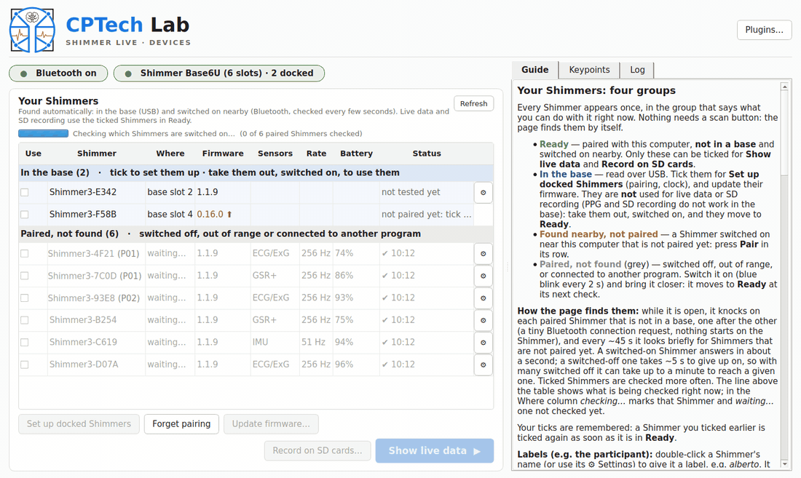
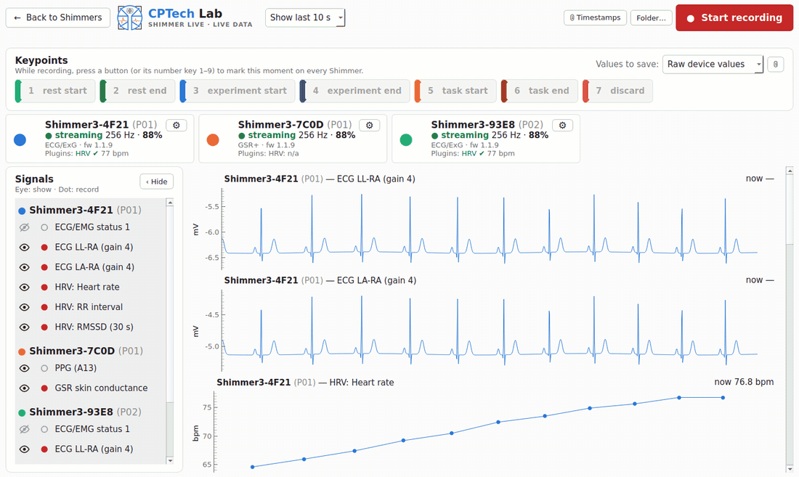
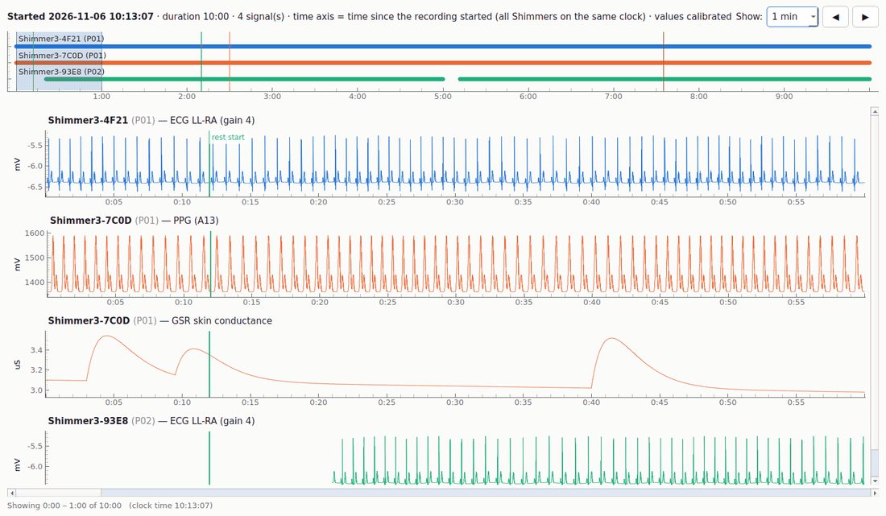
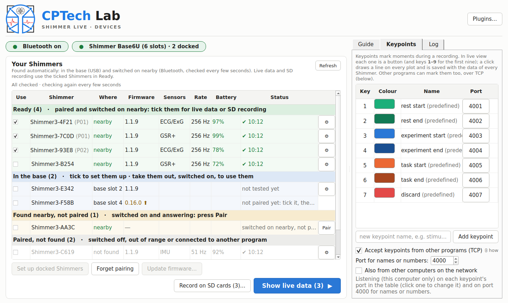
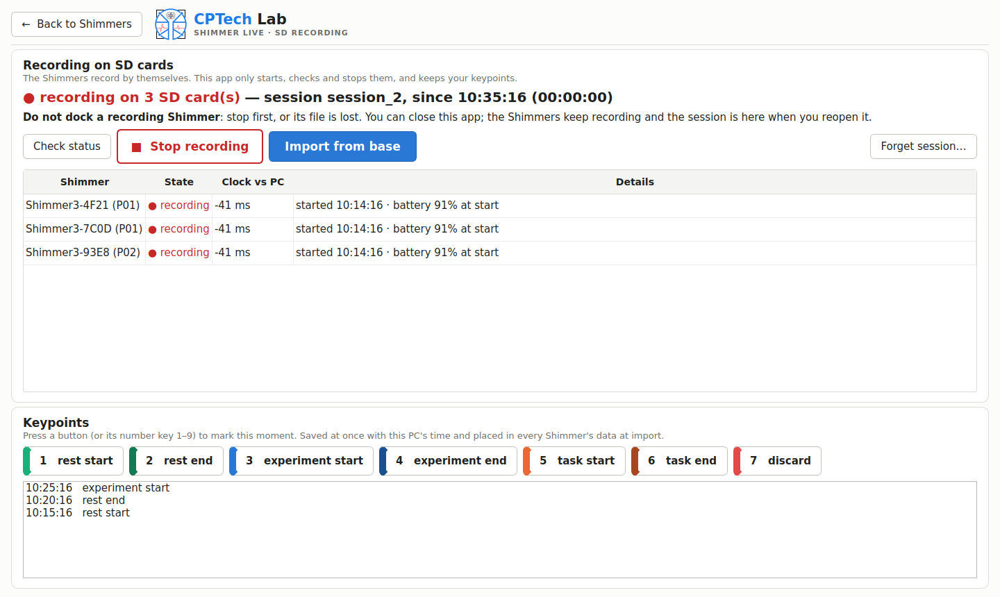
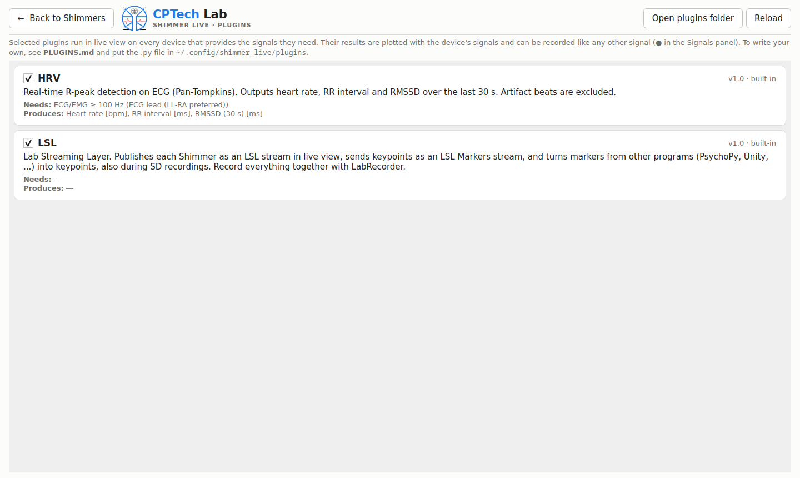
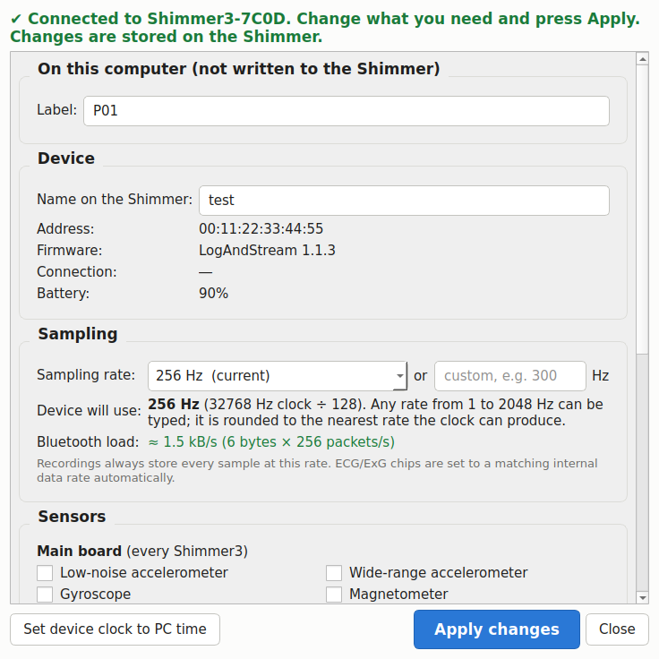

# Shimmer Live

Desktop app (Linux and Windows) to pair Shimmer3 sensors, view their data in real time, mark keypoints, run analysis plugins such as real-time HRV, and record everything to a single ZIP of Consensys-style CSV files with quality checks and notes.

## A quick tour

**Finding your Shimmers.** The start page groups every Shimmer by what you can do with it now. It finds the docked ones over USB, and checks over Bluetooth which paired ones are switched on nearby, one after the other.



**Live view.** Signals from every Shimmer, labelled with the participant. Start a recording and mark keypoints with a click or the keys 1–9. The HRV plugin computes the heart rate live.



**Reviewing a recording.** After *Stop recording* (or an SD import), *View signals…* shows everything on one time axis. Drag the box in the overview to move through hours of data, and see the keypoints, late starts and gaps.



| Keypoints and TCP ports | Recording on SD cards |
|---|---|
|  |  |
| **Plugins (HRV, LSL)** | **Device settings and labels** |
|  |  |

*These pictures are made from the app itself with simulated Shimmers: `python tools/make_docs_media.py` makes them again (needs ffmpeg).*

## Tutorials

### 1. First time: set up Shimmers from a base
1. Connect the Shimmer Base by USB, put the Shimmers in it and switch them on. They appear under **In the base** with their slot.
2. Tick them and press **Set up docked Shimmers**. The app pairs each one (PIN 1234 entered for you), tests it and sets its clock. The Status column shows *ready* or the problem.
3. Optional: double-click a Shimmer's name to give it a **label**, e.g. the participant (`P01`).
4. Take them out of the base, switched on. Within seconds they move to **Ready**, ticked.

No base? Switch the Shimmer on near the computer. It appears under **Found nearby, not paired** within about a minute; press **Pair**.

### 2. Record an experiment in live view
1. On the start page, tick the Shimmers in **Ready** and press **Show live data**. At most 6–7 can stream at once; for more, see tutorial 3.
2. In the **Signals** panel, the eye shows or hides a signal and the dot selects whether it is recorded. ECG and EDA are on by default; switch on PPG (A13) if you use the optical probe.
3. Choose **Values to save**: *Calibrated (mV, µS)* gives Consensys-style columns, *Raw* keeps the device's integers (the formulas are saved too).
4. Press **Start recording**. Mark moments with the keypoint buttons or the keys **1–9**.
5. Press **Stop recording**. The save dialog shows the quality checks. Give the recording a name, add notes, use **View signals…** to look through it, and press **Save recording** (one ZIP).

### 3. More Shimmers than Bluetooth allows: record on their SD cards
1. Tick the Shimmers in **Ready** and press **Record on SD cards…**, then name the session. Each Shimmer gets its clock set and starts recording on its own card.
2. Mark keypoints on the SD page, as in live view. You can close the app; the session is still there when you reopen it.
3. Press **Stop recording** before docking them.
4. Dock them and press **Import from base**. The usual save dialog opens, with the same ZIP layout as a live recording.

### 4. Review and save a recording
In the save dialog, **View signals…** opens the viewer:
- **Overview strip:** one bar per Shimmer where it has data, plus the keypoints. Drag the shaded box or click to jump.
- **Show:** 5 s to 10 min at a time. The scrollbar, ◀ ▶ and the arrow keys move all signals together.
- **Gaps:** shaded in red; a Shimmer that started late begins further right.

To analyse the ZIP in Python: `examples/load_recording.py` (see [Analysing recordings](#analysing-recordings)).

### 5. Mark keypoints from another program
- **TCP:** tick *Accept keypoints from other programs* in the **Keypoints** tab. Each keypoint has its own port (4001, 4002, … at first; click one in the table to change it). Send any line to it to mark that keypoint, e.g. `python -c "import socket; socket.create_connection(('127.0.0.1', 4005)).sendall(b'\n')"`. The *port for names or numbers* (4000) takes a keypoint's name or number, so one connection can mark any keypoint.
- **LSL:** tick **LSL** on the Plugins page. Markers from PsychoPy, Unity, … whose text is a keypoint name or number become keypoints. The Shimmers and your keypoints are published as LSL streams for LabRecorder.

Both work during live and SD recordings, and the time is taken when the message arrives.

### 6. Update a Shimmer's firmware
1. Put the Shimmer in the base. Highlight it and press **Update firmware…**, or use *Firmware…* in its ⚙ Settings.
2. Its configuration is saved, the official image is written and verified, and the configuration is restored. This takes about 1 minute.
3. Switch the Shimmer **off and on** once when asked.

## Run

- **Windows, no Python needed:** download `ShimmerLive-<version>-windows.zip` from the [Releases](https://github.com/CP-Tech-Research-Lab/shimmer_live/releases) page, unzip it anywhere and run `ShimmerLive\ShimmerLive.exe`. The first time, Windows SmartScreen may say "Windows protected your PC" because the app isn't signed: click *More info* → *Run anyway*. Each version tag (`v0.3.1`, …) builds this zip automatically on GitHub; to build it yourself on a Windows PC, run `setup_windows.bat` once, then `build_windows.bat` (result in `dist\ShimmerLive`).

- **Linux:** `./run_linux.sh`
- **Windows:** double-click `run_windows.bat`. It needs Python 3.11+ from python.org, with "Add to PATH" or the `py` launcher. See [Windows installation and troubleshooting](WINDOWS.md).

The first run creates `.venv` and installs `requirements.txt`. The Windows launcher validates installation, retries incomplete setup and notices requirement changes; `setup_windows.bat --repair` reruns installation and checks. Each PC creates its own environment. After that you can also start the app with `python -m shimmer_live` from inside the venv.

## Using it

For a Shimmer3 GSR+ optical pulse probe, select **PPG optical probe** in device Settings. This enables **Internal ADC A13** and makes sure the **3 V expansion power** setting is ON (it is written only if it is OFF). The Shimmer then powers the probe only while streaming or recording to SD: the green LED is on during acquisition and off otherwise. **PPG does not work while the Shimmer is in a base or dock**: there the probe loses power about a second after acquisition starts (LED off, A13 reads 0); live view warns about it. Also enable **GSR (GSR+ board)** for EDA. The PPG choice is remembered per device on this PC; the ADC and power settings are stored on the Shimmer. In Live data, use the eye and record dot for **PPG (A13)** to display and save PPG (in mV, as Consensys).

1. **Start page (Devices).** Status pills at the top show whether Bluetooth is on and whether a Shimmer Base is connected. **Your Shimmers** lists every Shimmer once, in four groups, each with a title row and its own background colour:
   - **Ready:** paired, **not in a base** and switched on nearby. Only these can be ticked for *Show live data* and *Record on SD cards*.
   - **In the base:** read over USB. Tick them for *Set up docked Shimmers*; firmware updates. Docked Shimmers are never used for live data or SD recording (PPG and SD recording do not work in the base): taken out switched on, they move to Ready.
   - **Found nearby, not paired:** a Shimmer switched on nearby that this computer is not paired with, with a *Pair* button in its row.
   - **Paired, not found** (grey): switched off, out of range or connected to another program.
   Every button explains itself when you hover over it.
   - **Battery, sensors, rate, firmware** are read automatically from every Shimmer in Ready when it gets there and then every 5 minutes, one at a time (the knocks pause meanwhile). A failed reading keeps the last good values and shows the error in Status. A Shimmer waiting to be switched off and on after a firmware update is tried every 20 s.
   - *Forget pairing* removes this computer's pairing (docked Shimmers can be set up again with one click).
   - *⚙ Settings* connects to the device and shows its firmware, battery and configuration. From there you can change the sampling rate (a preset, or any value typed from 1 to 2048 Hz; the dialog shows the exact rate the device will use, since it divides a 32768 Hz clock by a whole number, e.g. 300 Hz → 32768 ÷ 109 = 300.62 Hz) with an estimate of the Bluetooth load, enabled sensors, ECG/ExG gains, GSR range and device name, and set the device clock to the PC's time. Changes are written to the Shimmer and read back to verify them.
   - **Shimmers in a base** (fastest way to set them up): when a Shimmer Base or Dock is connected by USB, the app notices it and shows each docked Shimmer in the list with its slot, read over USB (address and firmware). Tick the docked Shimmers you want and press *Set up docked Shimmers*: for each ticked one it pairs it by address (PIN 1234 entered automatically; you're asked only if it's refused), tests the connection and sets its clock, and shows "ready" or the problem in plain words. Logging-only firmware (SDLog) is flagged, since it can't stream. Existing pairings are preserved after connection failures; the Shimmer is checked again automatically once it is in Ready. Use Forget pairing explicitly if a pairing needs replacing. On a Base6U with 6 Shimmers: reading the slots takes ~15 s, setup ~7–10 s per Shimmer.
   - **How the groups are found:** While the start page is open the app knocks on each paired Shimmer that is not docked, one after the other: a bare Bluetooth connection request (L2CAP to the SDP service on Linux, an uncached SDP query on Windows) that a switched-on Shimmer answers in ~1 s without anything starting on it; a switched-off one fails after the 5 s page timeout. Knocks cannot overlap (the radio pages one device at a time), so each round spends at most ~12 s, found Shimmers first, then the ones not checked yet, then the rest in rotation (ticked ones more often), followed by a 3 s pause. A line above the table shows what is being checked right now (with a moving bar while work is pending); the *Where* column says *nearby*, *checking…*, *waiting…* (not checked yet) or *not found*. Every ~45 s a short discovery (6 s) looks for Shimmers that are not paired yet; they are shown once they answer a knock, and forgotten after 3 unanswered knocks. A Shimmer moves to Ready at its next check after being switched on. A found Shimmer turns grey after two missed knocks. Earlier ticks are remembered. Checks pause while a reading, pairing or setup uses Bluetooth, and stop when you leave the page. A plain Bluetooth discovery is not used: while another program keeps one running (KDE does), BlueZ keeps every device's last signal and reports devices switched off hours ago as present. Verified on Linux with 12 paired Shimmers (2 on: found in 0.7–1.7 s every time; 10 off: never). Windows: not yet run on hardware.
   - *Pair* (in a *Found nearby* row) pairs a Shimmer, retrying up to 4 times; the PIN 1234 is entered automatically, and a pop-up asks you only if it is refused. After pairing, the device is tested automatically and moves to Ready, ticked.
   - **Labels** (e.g. the participant wearing a Shimmer): double-click a Shimmer's name, or set *Label* in ⚙ Settings. Shown in grey after the name — *Shimmer3-A281 (alberto)* — on the start page, in live view (cards, plot titles, Signals panel, alerts) and on the SD recording page, and saved with every recording: `devices.csv` (Device, Label, Address, Kind, Firmware, Sampling_Rate_Hz) and `info.json` in the ZIP. A recording keeps the label it had at its start. Labels are stored on this computer only; the Shimmer's own name (*Name on the Shimmer* in Settings, used by Consensys and its SD files) and its Bluetooth name are not changed. CSV file names and column prefixes keep the Bluetooth name, so analysis scripts are unaffected.
   - Tabs on the right:
     - *Guide:* how to connect a Shimmer, what the LEDs mean, and what to do when a device doesn't respond.
     - *Keypoints:* the 7 predefined keypoints (rest, experiment and task start/end, discard) plus your own, each with a colour.
     - *Log:* everything the app does.
   - *Plugins…* opens the plugin page (see below).
2. **Show live data.** One plot per signal, coloured per device, with a 5–60 s window.
   - Signals above 128 Hz are averaged to about 128 Hz for display only; recordings keep every sample.
   - Each device has a status card: state, received vs. nominal sampling rate, battery, plugin status, and a ⚙ button with device info.
   - **Values to record** (top left): *Raw device values* (default) or *Calibrated (mV, µS)*. See [Calibration](#calibration).
   - The **Signals panel** (left) has two buttons per signal, plugin outputs included:
     - **eye** shows or hides the signal in live view;
     - **dot** selects whether it is recorded. Record choices lock once a recording starts.
3. **Keypoints.** While recording, a button per keypoint (keys **1–9** for the first nine) marks the current moment. A line in the keypoint's colour appears on every plot, and the keypoint is saved with every Shimmer's data.
   - **From other programs (TCP).** Another program (stimulus script, game engine, …) can mark a keypoint by sending one line over TCP. Each keypoint has its own **fixed port**: 4001, 4002, … at first, in list order. Change one by clicking it in the *Port* column; a port already in use is refused, and a new keypoint gets the next free port. Anything sent to a keypoint's port (even just a newline) marks it. The **port for names or numbers** (default 4000) takes a keypoint's name or number instead, so one connection can mark any keypoint; changing it never moves the keypoints' ports. The time is taken the instant the line arrives (well under 1 ms after it is sent, locally). The app answers `OK <name> <unix ns>`, or `ERR not recording`. It works during live recordings and SD recordings; `keypoints.csv` has a *Source* column (`button` or `tcp:<port>`). Settings are in the *Keypoints* tab: on/off, the port for names or numbers, and whether other computers may connect (off by default: this computer only). Example: `python -c "import socket; socket.create_connection(('127.0.0.1', 4005)).sendall(b'\n')"`.
4. **Plugins.** Plugins ticked on the Plugins page run on every device that has the signals they need. Their outputs are plotted and can be recorded like any other signal. Built in: **HRV**, real-time R-peak detection on ECG giving heart rate, RR interval and RMSSD over the last 30 s, with artifact beats excluded. To write your own, see [PLUGINS.md](PLUGINS.md).
   - **LSL** (built in, tick it on the Plugins page): the Lab Streaming Layer bridge.
     - *Shimmer data:* in live view, each Shimmer becomes an LSL stream named like `Shimmer3-A281 (alberto)`, with every streamed channel in calibrated units at its sampling rate. Samples are timestamped when they were taken, on the shared clock, which is LSL's `local_clock()`.
     - *Keypoints out:* every keypoint goes out on a Markers stream, `Shimmer Live keypoints`.
     - *Markers in:* every other program's Markers stream (PsychoPy, Unity, …) is followed. A marker whose text is a keypoint name or number becomes that keypoint, at the marker's own time, corrected to this PC's clock. During a live or an SD recording only, like the TCP keypoints.
     - *Recording everything together:* use LabRecorder to save the Shimmers with other LSL devices in one `.xdf` file.
     - *Tested:* on Linux, over real LSL on one computer. Markers arrived within 0.1 ms of their send time. Needs `pylsl`, which is in requirements.txt and bundles liblsl.
5. **Alerts:**
   - Red banner: lost connection. The app reconnects automatically.
   - Red banner with a *Retry* button: the device could not connect.
   - Amber or red banner: low battery (below 20% / below 10%).
   - Amber banner: packet rate below 85% (weak link).
   - Amber banner: an ECG channel at full scale (lead off).
   - Amber banner: GSR with no skin contact.
   - Amber banner: a plugin error.
   - Amber banner: low disk space.
   - While recording, a large flashing red panel shows *"LOST CONNECTION — device — hh:mm:ss and counting"*.
6. **Recording.**
   - *Stop recording* opens the save dialog. It shows a summary per device (samples received vs. expected, connection losses, time lost) and the **quality checks**, and has a **name** field and a **notes** box. *Save* writes the ZIP.
   - **View signals…** in the save dialog (after *Stop recording* and after an SD import) opens a viewer with every recorded signal on one time axis: time since the recording started, with all Shimmers on the same clock, so a late start lines up correctly.
     - *Overview:* a strip with one bar per Shimmer showing where it has data, plus the keypoints. The shaded box is what's shown below: drag it like a slider, or click anywhere to jump.
     - *Window:* 5 s, 10 s, 30 s, 1 min (default), 5 min or 10 min, moved by one scrollbar for all signals. ◀ ▶, the arrow keys and Page Up/Down also move it.
     - *What is drawn:* keypoints as coloured lines, gaps as breaks with shaded areas for gaps ≥ 0.5 s. Values are calibrated, and each y-axis fits what is visible.
     - *Speed:* each redraw cuts out the visible window and reduces it to ~2 points per pixel (min/max, so spikes stay visible). With 2 h at 512 Hz (3.7 M samples per signal), the viewer opens in about 0.5 s and scrolls in 10–25 ms.
   - Closing the dialog never loses the recording. *Discard* deletes it after confirmation.
   - While recording, data goes to crash-safe working files. If the app closes during a recording, it offers to recover it at the next start.
   - Recordings go to `~/Documents/ShimmerRecordings`; change this with *Folder…*.
   - *ⓘ Timestamps* shows which system clock functions are used on this machine, and how other systems can sync with the recording.

7. **Recording on SD cards** (*Record on SD cards…* on the start page). Each ticked Shimmer records on its own SD card with no Bluetooth link, so any number can record at once. Bluetooth allows only 7 live connections.
   - **Start:** take the Shimmers **out of the base**, because a docked Shimmer does not record. The app connects to each one in turn, sets its clock to this PC's time with sub-second precision, writes the session name, starts it, and confirms on a new connection that it is recording.
   - **While they record:** the SD recording page shows each Shimmer's state and marks **keypoints** (keys 1–9). Keypoints are saved at once with this PC's time. *Check status* confirms each Shimmer is still recording. You can close the app: the session is kept in the settings and is there when you reopen it.
   - **Stop:** press *Stop recording* **before docking** the Shimmers. Docking a Shimmer while it records ends the recording without closing the file, which then reads as 0 bytes. This was verified on a Shimmer3.
   - **Import:** dock the Shimmers and press *Import from base*. For each one, the base shows its SD card to the PC (`SDC,NN$`). The app copies that session's files, converts them, and opens the usual save dialog (quality checks, name, notes). The ZIP has the same layout as a live recording, plus the original binary files in `sd_raw/`. Nothing is deleted from the cards.
   - **Timing:** each Shimmer clock − PC clock offset is measured over Bluetooth, keeping the fastest of several round trips, at start and again at stop. Sample times are corrected along the line between the two, which removes crystal drift. Expect an accuracy of tens of ms.
   - **Confirmation:** if a Shimmer does not answer after the start command, it is shown as *started, not confirmed*, never as failed, because it may well be recording. *Check status* resolves it, and *Stop* includes it.
   - **Firmware 0.15/0.16:** Bluetooth can lock up right after the SD start. This happened on three RN4678 units in testing, and Shimmer fixed it in 1.00.015. Those units must then be stopped with their own button before docking, and the app warns before starting them.
   - **Short gaps:** gaps of 10–120 ms are normal in SD logs. They appear once a minute, and when the app connects to a logging Shimmer on firmware older than 1.01.009. Only gaps of 1 s or more count as interruptions, and completeness is measured over each Shimmer's own recording period.
   - **Requirements:** LogAndStream firmware and an SD card. On Linux the card is mounted with `udisksctl`, without root. On Windows it gets a drive letter; retrieval, parsing and export were verified on one Shimmer3. A clean software-controlled SD start/stop cycle on Windows remains unverified.

**Limits found in testing** (Linux, Intel AX211 Bluetooth, 2 Base6U, 12 Shimmers):
- **Live streaming:** at most **6 Shimmers at once** on this PC. Linux refuses the 7th with "Too many links". The app reports this, remembers the limit and warns before opening live view with more. Use SD recording for more.
- **Several bases:** any number is supported, shown as *base A · slot 3* and so on, and they are read in parallel.

**Updating firmware** (⚙ Settings → *Firmware…*, or *Update firmware…* on the start page with one docked Shimmer highlighted; the Shimmer must be in the base). The app backs up its configuration and calibration (`~/Documents/ShimmerFirmwareBackups/`), writes the new LogAndStream through the base's bootloader channel, verifies every block with the chip's own checksum, and restores the configuration. Going from 0.x to 1.x it clears a "Bluetooth disabled" setting that 0.x ignored and 1.x obeys. Only official images with a known SHA-256 are offered, from `~/Documents/ShimmerFirmware/`; 1.1.9 is downloaded from Shimmer's GitHub if missing. Afterwards switch the Shimmer off and on once and press *Test connection* in the same window. If an update fails, the bootloader is untouched: run it again. `tools/fw_flash.py` does the same from the command line, and `tools/fw_check.py` records a before/after comparison. Tested on Linux with a Base6U; the Windows path has not been run yet.

## Recording format

`[name_]shimmer_YYYY-MM-DD_HH-MM-SS.mmm_UTC+hhmm.zip`. The file name always includes the exact start time.

| file | content |
|---|---|
| `<device>.csv` | one per Shimmer, in the Consensys "Calibrated" layout: a `"sep=,"` line, a row of column names, a row of units, then data |
| `<plugin> - <device>.csv` | plugin outputs, e.g. `HRV - Shimmer3-8395.csv` with heart rate, RR and RMSSD per beat |
| `keypoints.csv` | every keypoint with its time on every clock, including each Shimmer's own clock |
| `qc.csv` | the quality checks shown at save time |
| `info.json` | notes, app version, devices, plugins, connection losses/reconnects, clock sources |
| `notes.txt` | the notes, as plain text |

Every device and plugin file starts with three timestamps:

| column | unit | meaning |
|---|---|---|
| `<device>_Timestamp_Unix_CAL` | ms | sample time on the PC wall clock (UTC epoch), the same convention as Consensys |
| `<device>_Timestamp_Shared_CAL` | s | sample time on the shared clock. On Windows this is `QueryPerformanceCounter`, computed exactly like Unreal Engine's `FPlatformTime::Cycles64() * FPlatformTime::GetSecondsPerCycle64()`; on Linux, `CLOCK_MONOTONIC` |
| `<device>_Timestamp_CAL` | ms | Shimmer clock (32768 Hz crystal), 0 = first sample of the live session |

The two PC timestamps are *sampling* times, not packet arrival times. Bluetooth delays packets by tens to hundreds of milliseconds. For each connection period, the Shimmer clock is fitted to the PC clock along the lower edge of the arrival times (the lower convex hull); this removes the latency and corrects clock drift. In tests with simulated latency, this recovers sampling times to within about 1 ms.

The channels follow Consensys naming (`ECG_LL-RA_24BIT`, `ECG_LA-RA_24BIT`, `ECG_RESP_24BIT`, `ECG_Vx-RL_24BIT`, `GSR_Skin_Conductance`, `Battery`, …). By default they hold **raw device values** and end in `_RAW`. With *Calibrated* selected they hold physical units and end in `_CAL`, plus the derived `ECG_LL-LA_24BIT_CAL` as in Consensys. The last column, `<device>_Keypoint`, holds the keypoint name at the nearest sample.

## Calibration

Raw values are integers exactly as the Shimmer sent them; nothing is lost. The live plots, plugins and quality checks always use calibrated values. These are the nominal Shimmer3 conversions, the same ones Consensys and pyshimmer use for these sensors. Each recording's `info.json` also lists, per column, the formula and its parameters (e.g. the ECG gain read from the device), and the live view has an *ⓘ How values are calibrated* button.

| sensor | raw value | calibrated value |
|---|---|---|
| ECG/ExG (ADS1292R) | 24-bit signed integer | mV = raw × (2420 / gain) / (2²³ − 1). 2420 mV is the chip reference; gain is 1, 2, 3, 4, 6, 8 or 12, read from the chip at connect. ±8388607 = saturated (lead off) |
| GSR+ | 16-bit word: bits 15–14 = range, bits 11–0 = ADC | range selects Rf = 40.2 kΩ / 287 kΩ / 1 MΩ / 3.3 MΩ; V = ADC × 3.0 / 4095; R (kΩ) = Rf / (V / 0.5 − 1); conductance (µS) = 1000 / R. V ≤ 0.5 V means no skin contact (empty) |
| Battery | 12-bit ADC | mV = raw × 3000 / 4095 × 1.988 |
| Internal / external ADC (PPG on A13) | 12-bit ADC | mV = raw × 3000 / 4095, as Consensys. On a GSR+ unit A13 is named `PPG_A13_CAL`; others `Int_ADC_A<n>_CAL` / `Ext_ADC_A<n>_CAL` |
| ECG/EMG status, accelerometer, gyroscope, magnetometer, other channels | as sent | not calibrated (Consensys converts the IMU with calibration values stored in each Shimmer; not done here yet) |

**Checked against Consensys** (Shimmer3-A281 and an ECG unit, 5 trials exported by Consensys, November 2026). Every calibrated ECG, EDA and PPG value in those files converts back to an exact raw integer with these formulas, so values from this app and from Consensys are directly comparable. In *Calibrated* mode the columns are also named as in Consensys, including the derived `ECG_LL-LA_24BIT_CAL` and `GSR_Skin_Resistance_CAL` (kΩ). Consensys' own SD files start with about 0.2 s of start-up samples (EDA range 0/1, a constant 125 µS) and contain occasional single-sample EDA spikes where the GSR switches range on its own. Recordings made by this app use a fixed range and have neither.

The formulas live in one place in the code, `shimmer_live/conversions.py` (`CALIBRATION_DOC` and `calibrate_array`). A test checks that converting a recorded raw column gives exactly the values the live view shows.

The **quality checks** are heuristics with thresholds listed in `shimmer_live/qc.py`. They flag likely problems; they are not a clinical assessment:
- completeness and connection losses;
- ECG: saturation (lead off), flat signal, amplitude, 50/60 Hz mains interference;
- EDA: skin contact, implausible range, abrupt-change artifacts, flat signal;
- heart rate range (with the HRV plugin), battery, and unmatched start/end keypoints.

## Analysing recordings

[`examples/load_recording.py`](examples/load_recording.py) loads a recording ZIP with pandas:

```
python examples/load_recording.py recording.zip             # summary, notes, keypoints, QC problems
python examples/load_recording.py recording.zip --plot      # every channel, with keypoint lines
python examples/load_recording.py recording.zip --extract   # unzip next to the file
```

In your own code, `load_recording("recording.zip")` returns the devices and plugin outputs as DataFrames, plus the keypoints, QC, info and notes. It only needs pandas, so it can be copied on its own.

## Layout

```
shimmer_live/
  session.py        connect / stream / watchdog / auto-reconnect for one device
  transport.py      Bluetooth links (Linux RFCOMM socket, Windows COM port or socket)
  recorder.py       crash-safe working files while recording
  export.py         working files -> final ZIP (aligned timestamps, keypoints, QC, notes)
  alignment.py      Shimmer clock -> PC clock (lower convex hull per connection period)
  qc.py             quality checks
  keypoints.py      keypoint definitions
  plugins/          plugin interface (api.py), loader, host, built-in plugins (HRV)
  clocks.py         system timestamps and the shared clock
  conversions.py    raw values to physical units, Consensys channel names
  device_config.py  read / change on-device settings
  base.py           Shimmer Base6U/Base15U and Dock over USB: slots, addresses, firmware, clock
  dock_setup.py     one-click setup of docked Shimmers (pair, test, set clock)
  sdlog.py          recording on the Shimmers' SD cards: start/check/stop, clock offsets, import
  bt/               pairing and discovery: bluez.py (Linux, D-Bus), windows.py (WinRT)
  ui/               Qt pages and dialogs
examples/           recording loader, example plugin
```

## Platform notes

- **Linux:** no root needed. The app opens RFCOMM sockets directly; `rfcomm bind` is not needed. The RFCOMM channel is looked up through SDP (`sdptool`). If that fails, the app tries channels in turn, and caches the result. Settings, logs and user plugins are stored in `~/.config/shimmer_live/`.
- **Windows:** streaming goes through the outgoing Bluetooth COM port that Windows creates when you pair a Shimmer. Settings, logs and user plugins are stored in `%APPDATA%\ShimmerLive\`. Pairing and connections were verified on Windows 11 with an Intel AX201 and eleven docked LogAndStream Shimmers, with up to four streaming simultaneously. One unit later stopped answering on reconnect and required a docked power cycle; long-term reconnect reliability remains unverified. **Connect a desktop PC's external Wi-Fi/Bluetooth antenna even when using Ethernet**: missing antennas caused widespread pairing failures and sample loss on the test PC. Default dependencies remain general; an [optional pandas compatibility profile](WINDOWS.md#optional-pandas-compatibility-fallback) is available for a Windows DLL-blocking issue observed on one PC.

## Tests

```
pip install -r requirements-dev.txt
python -m pytest
```

The tests run without Bluetooth. They cover:
- unit conversions;
- timestamp unwrapping across 24-bit wraps and reconnects;
- the recording pipeline end to end: timestamp alignment against known sampling times with simulated Bluetooth latency, keypoints, selected channels, the ZIP layout, notes and crash recovery;
- the quality checks;
- the HRV plugin against synthetic ECG with known beat times;
- plugin loading and isolation of plugin errors;
- plot decimation, ECG register edits and the shared clock.

They also import every module and build the UI pages off-screen.

GitHub Actions runs them on Linux and Windows (Python 3.11 and 3.14) on every push. The Windows job also runs the Windows shared-clock code and checks every WinRT call the Windows backend uses.

## License

GPL-3.0. See [LICENSE](LICENSE). The app uses [pyshimmer](https://github.com/seemoo-lab/pyshimmer), which is also GPL-3.0. You may use, modify and share it; if you distribute it, you must include the source code under the same license.
